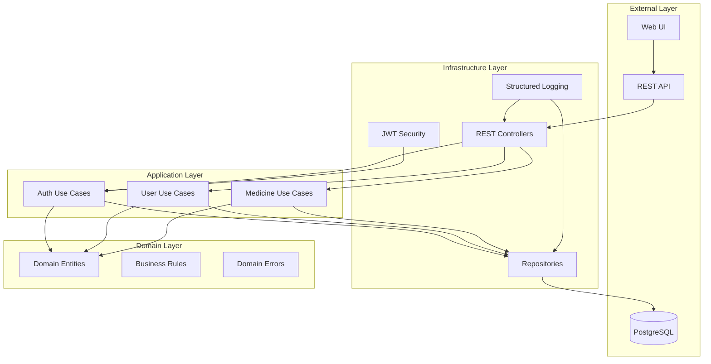
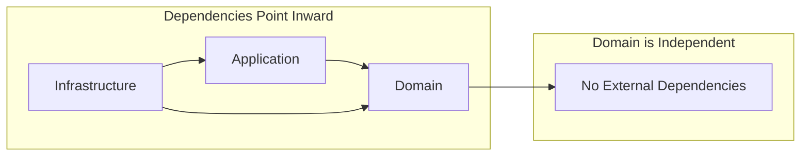

# Golang Microservices - Clean Architecture

A production-ready microservices boilerplate built with Go, implementing Clean Architecture principles with comprehensive testing, security, and documentation.

## 🏗️ Architecture Overview

### Clean Architecture Layers

### Dependency Flow

